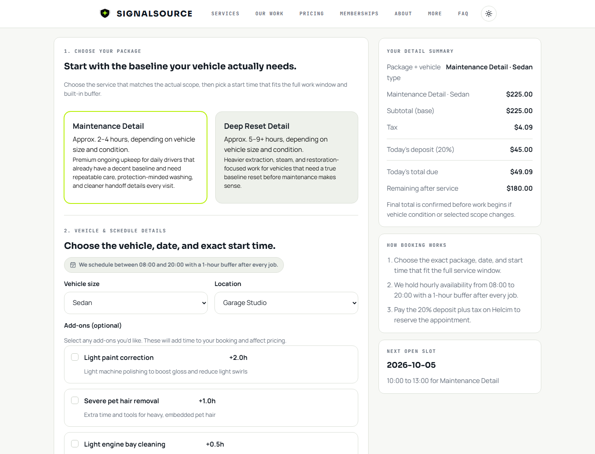
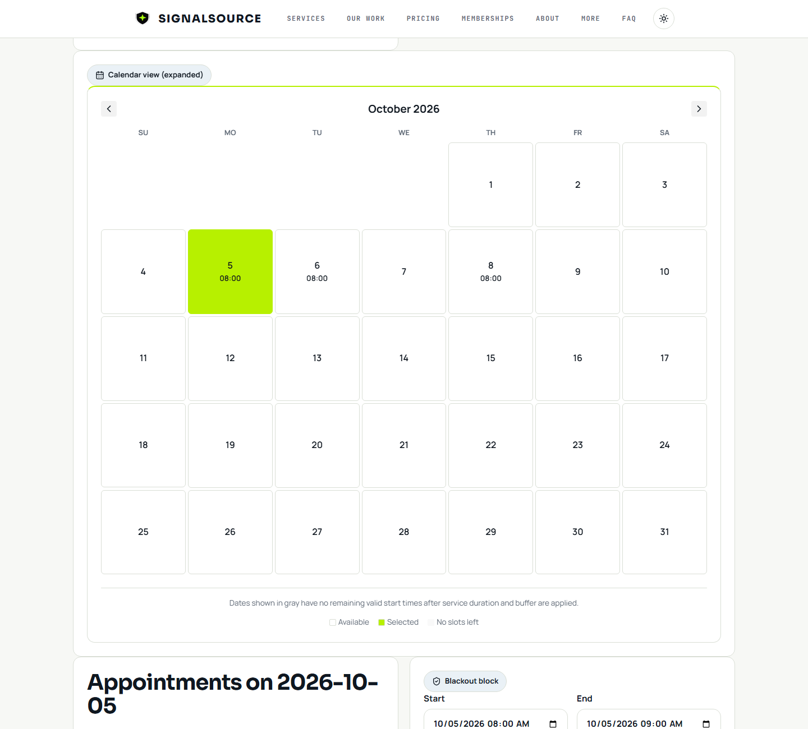

# SignalSource

SignalSource is a car-detailing booking and scheduling application. Customers compare services, choose a vehicle size and add-ons, view availability, and submit a booking. Owner tools manage appointments, payment status, blackout periods, and private vehicle photos.

## Functionality

- Maintenance and Deep Reset packages with vehicle-based pricing, mobile service fees, and optional add-ons.
- Pacific-time scheduling with hourly starts, checkout holds, overlap checks, and daily capacity limits.
- Two-day allocation for eligible Deep Reset / Large SUV-Truck jobs, skipping Sundays.
- Owner scheduling, manual reservations, blackout periods, and protected photo retrieval.
- Hosted Helcim checkout and Resend confirmation-email integrations.
- Service information, memberships, detailing gallery, and downloadable resources.

## Screenshots

Actual application screens using the project's detailing photography. Booking and owner examples use synthetic data.





[Mobile gallery view](docs/screenshots/detailing-mobile.png)

## Architecture

The React frontend calls Supabase Edge Functions. Functions validate booking inputs and recompute prices and times. PostgreSQL triggers serialize schedule changes and write capacity segments atomically; conflicts roll back the transaction. Public availability reads the same reservations.

Owner endpoints verify a server-held passcode. Customer tables and photo storage are private. Booking status and photo uploads require a per-booking capability. See [architecture and security](docs/architecture.md).

**Stack:** React 19, TypeScript, Vite, React Router, Supabase/PostgreSQL, Deno, Helcim, Resend, Vercel, Vitest, Playwright, and PGlite.

## Local Setup

Install Node.js 24 LTS, which includes npm.

```sh
cd website
npm ci
cp .env.example .env.local
npm run dev
```

In PowerShell, use `Copy-Item .env.example .env.local` instead of `cp`. Open the local URL printed by Vite.

Set `VITE_SUPABASE_URL` and `VITE_SUPABASE_ANON_KEY` for your development project. These are public client values. Server credentials must never use a `VITE_` prefix. See [environment configuration](ENV_VARIABLES.md).

Use the [backend setup instructions](DEPLOYMENT.md) for a new database and Edge Functions. Browser tests mock external services and do not require Supabase credentials. Local browser access to a hosted backend requires a matching CORS origin.

## Repository Layout

- `website/src/`: pages, components, API clients, pricing, and scheduling rules.
- `website/tests/`: browser, validation, database, and concurrency tests.
- `supabase/functions/`: booking, availability, owner, upload, payment, and email endpoints.
- `supabase/bootstrap/`: clean database baseline and private photo storage setup.
- `supabase/migrations/`: schema history; use the documented allowlist for new installations.
- `docs/`: architecture and application screenshots.

## Testing

From `website/`:

```sh
npm run lint
npm run typecheck
npm run test:unit
npm run test:db
npx playwright install chromium
npm run test:e2e
npm run build
npm audit
```

Unit and database tests cover pricing, durations, overlaps, two-day allocation, rollback, permissions, webhook signatures, quotas, and email-delivery claims. PGlite runs the database tests without a hosted project.

Browser tests cover customer and owner flows, navigation, responsive layouts, and error states. Payment and email requests are mocked; these tests do not charge cards or send mail.

Set `CAPTURE_SCREENSHOTS=1` when running the browser tests to regenerate the screenshots in `docs/screenshots/` with synthetic booking data.

For independent-connection race tests, provision an empty PostgreSQL database named `signalsource_test`, set `TEST_DATABASE_URL`, and run `npm run test:concurrency`. The runner refuses other database names. CI uses PostgreSQL 17.

Check Edge Functions with Deno from the repository root:

```sh
deno check supabase/functions/*/index.ts
```

## Deployment Status

The Supabase staging backend is deployed. Staging checks have verified booking/capacity behavior, private photo upload/retrieval, and confirmation-email acceptance using Resend's test recipient. Human-inbox delivery and live payment processing have not been verified.

The public Vercel project is paused. Production requires database prerequisites before a coordinated backend rollout. A frontend deployment does not apply Supabase migrations. See [deployment configuration and release order](DEPLOYMENT.md).

## Known Limitations

- Helcim signature verification and event logging are implemented; automatic transaction-to-booking matching is not verified. Payment reconciliation remains manual.
- Owner access uses a shared passcode stored in the browser session, without individual accounts or MFA.
- The scheduler serves one detailer. Multi-day allocation supports exactly two service days for the eligible package/vehicle combination.
- Web checkout holds expire after 15 minutes. Late payment confirmation must pass capacity checks again.
- Email delivery uses persistent claims and provider idempotency. Ambiguous attempts older than 23 hours require review; there is no background retry worker.
- Uploads are private and size/type checked. Storage retention, malware scanning, and image transcoding are not implemented.
- Membership selection records interest; it does not establish a recurring subscription.

## Project Assets

Detailing photos and SignalSource branding are supplied by the project owner. Screenshots show the application itself. No license to reuse the branding or photography is granted by this repository.
